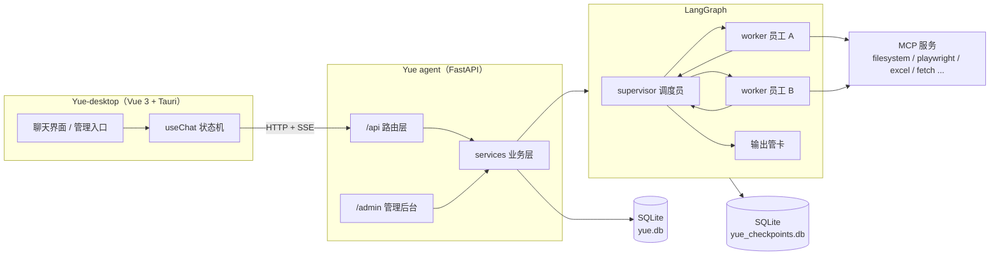

# Yue Agent

> 一个可以本地运行的多智能体（Multi-Agent）学习 Demo：**FastAPI + LangGraph + MCP + Vue 3 + Tauri**。

Yue Agent 的目标不是做一个开箱即用的产品，而是把「一个本地 AI Agent 应用需要哪些部件」完整地搭出来，并且让每一层都容易读、容易改：

- 后端：FastAPI 提供 HTTP + SSE 接口，LangGraph 负责多智能体编排，SQLite 负责持久化。
- 智能体：一个 `supervisor` 调度员 + 若干 `worker` 员工，员工可以调用 MCP 工具、加载技能、读写跨会话记忆。
- 前端：Vue 3 写的聊天界面，既能跑在浏览器里，也能用 Tauri 打包成桌面应用（内置 Python 后端）。
- 管理后台：在浏览器里配置模型厂商、员工、MCP 工具、技能和会话。

代码里的注释、文档和命名都偏教学向。适合拿来学习 LangGraph 的多智能体编排、MCP 工具接入、SSE 流式输出、人工审批（Human-in-the-loop）和 Tauri sidecar 打包。

---

## 目录

- [它长什么样](#它长什么样)
- [核心特性](#核心特性)
- [整体架构](#整体架构)
- [目录结构](#目录结构)
- [快速开始](#快速开始)
- [首次配置](#首次配置)
- [一次对话发生了什么](#一次对话发生了什么)
- [值得学习的实现点](#值得学习的实现点)
- [HTTP / SSE 接口](#http--sse-接口)
- [配置说明](#配置说明)
- [已知限制](#已知限制)
- [相关文档](#相关文档)

---

## 它长什么样

| 入口 | 说明 |
|---|---|
| `Yue-desktop` | 桌面聊天客户端：会话列表、流式回复、工具调用展示、审批弹窗、技能选择 |
| `http://127.0.0.1:8000/admin` | 管理后台：厂商、员工、工具、技能、会话、调试对话 |
| `http://127.0.0.1:8000/docs` | Swagger UI（`/redoc` 为 ReDoc） |
| `GET http://127.0.0.1:8000/` | 健康检查 |

后端和 UI 完全解耦：桌面端、浏览器、`curl` 调用的都是同一套 `/api`。

---

## 核心特性

- **多智能体编排**：`supervisor` 只做任务拆解和派工，员工各自拥有独立提示词、工具和上下文；最终答复经过「输出管卡」统一收束。
- **动态 MCP 工具**：MCP 配置存在数据库里，按员工挂载；支持本地 stdio、HTTP、SSE 等连接方式，启动后自动拉取工具清单。
- **技能系统**：技能正文保存在数据库，对话时可以指定 `skill_slug` 强制使用；正文过长时由模型按需调用 `load_skill`。
- **跨会话记忆**：按 `user_id` 隔离，对话前自动检索相关记忆注入提示词，员工也可以主动 `save_memory` / `search_memory`。
- **人工审批**：写文件、改文件、写 Excel、下载论文等敏感工具执行前会暂停，等待用户批准后从断点继续。
- **SSE 流式输出**：逐 token 推送，同时把节点切换、工具调用、token 用量、审批请求作为独立事件发给前端。
- **会话持久化**：会话、消息、跨会话记忆存在 `yue.db`；LangGraph 检查点存在 `yue_checkpoints.db`，用于审批中断后恢复。
- **桌面打包**：Python 后端用 PyInstaller 打成单文件 exe，作为 Tauri sidecar 随桌面应用一起分发，退出时自动结束子进程。

---

## 整体架构



一句话概括：**前端只认 HTTP/SSE，后端把「编排」交给 LangGraph，把「能力」交给 MCP，把「状态」交给 SQLite。**

---

## 目录结构

```text
Yue Agent/
├─ README.md
├─ doc/                          # 产品方案书、分镜表等
│
├─ Yue agent/                    # Python 后端
│  ├─ main.py                    # 启动入口（FastAPI + uvicorn）
│  ├─ pyproject.toml / uv.lock   # 依赖与锁定
│  ├─ .env.example               # 配置模板
│  ├─ build_sidecar.spec         # PyInstaller 打包配置
│  ├─ src/
│  │  ├─ settings.py             # pydantic-settings 全局配置
│  │  ├─ app/                    # FastAPI 分层
│  │  │  ├─ api/endpoints/       # 路由：chat / sessions / tools / skills ...
│  │  │  ├─ core/                # 数据库、鉴权、中间件、异常处理
│  │  │  ├─ model/               # SQLAlchemy 模型
│  │  │  ├─ schemas/             # Pydantic 请求/响应模型
│  │  │  └─ services/            # 业务逻辑（含 SSE 事件流）
│  │  └─ Yue/                    # LangGraph 智能体
│  │     ├─ agent/graph.py       # 构图入口：节点、边、缓存
│  │     ├─ nodes/nodes.py       # 调度员节点、员工子图、中间件
│  │     ├─ state/state.py       # 图状态 AgentState
│  │     ├─ tools/               # 路由、handoff、技能加载
│  │     ├─ memory/              # 跨会话记忆存储与工具
│  │     ├─ mcp.py               # MCP 服务加载与缓存
│  │     └─ checkpoint.py        # LangGraph SQLite 检查点
│  ├─ skills/                    # 17 个 SKILL.md 源文件
│  ├─ template/admin/            # 管理后台 Jinja2 模板
│  └─ data/                      # 运行时数据（数据库、arXiv 论文，已 gitignore）
│
└─ Yue-desktop/                  # 桌面客户端
   ├─ src/
   │  ├─ views/                  # Chat / Sessions / Memories / Agents / Models / Settings
   │  ├─ base/                   # 基础组件（按钮、卡片、气泡、Markdown ...）
   │  ├─ composables/useChat.js  # 对话状态机（SSE 事件处理）
   │  ├─ api/                    # fetch 封装、SSE 解析、资源接口
   │  └─ styles/tokens.css       # 设计变量
   ├─ scripts/build-all.ps1      # 一键：后端 exe → sidecar → Tauri 安装包
   └─ src-tauri/                 # Rust 外壳，dev 不启动后端，打包后启动 sidecar
```

---

## 快速开始

### 环境要求

| 依赖 | 版本 | 用途 |
|---|---|---|
| Python | 3.13+ | 后端 |
| [uv](https://docs.astral.sh/uv/) | 最新 | 安装 Python 依赖（也可用 `pip`） |
| Node.js | 20+ | 前端与部分 MCP 服务（`npx`） |
| Rust | stable | 仅打包桌面端时需要 |
| `uvx` | 随 uv 安装 | 运行 fetch / time / arXiv 等 MCP 服务 |

> MCP 工具是运行时按需拉起的：第一次对话会下载/启动 `npx`、`uvx` 服务，所以会慢十几秒；之后走进程内缓存。

### 1. 启动后端

```bash
cd "Yue agent"

# 安装依赖（推荐 uv，会按 uv.lock 创建 .venv 并以 editable 方式安装项目）
uv sync

# 准备配置
cp .env.example .env
# 编辑 .env，至少填写 AUTH_TOKEN、ADMIN_PASSWORD、ADMIN_SESSION_SECRET

# 启动
.venv/Scripts/python.exe main.py
```

非 Windows 平台把 `.venv/Scripts/python.exe` 换成 `.venv/bin/python`。

启动成功后：

- 健康检查：<http://127.0.0.1:8000/>
- 管理后台：<http://127.0.0.1:8000/admin>（账号密码来自 `.env` 的 `ADMIN_USERNAME` / `ADMIN_PASSWORD`）
- Swagger：<http://127.0.0.1:8000/docs>

如果没有安装 uv，也可以：

```bash
python -m venv .venv
.venv/Scripts/pip install -e .
```

### 2. 启动前端（浏览器模式）

```bash
cd Yue-desktop
npm install
npm run dev
```

打开 <http://127.0.0.1:1420>。开发服务器会把 `/api` 和 `/docs` 代理到 `http://127.0.0.1:8000`，不需要额外配置跨域。

### 3. 启动桌面端（开发模式）

```bash
cd Yue-desktop
npm run tauri dev
```

开发模式下 Tauri **不会**自动启动 Python 后端，需要先在另一个终端运行 `python main.py`，否则界面会显示离线。

### 4. 打包桌面应用

```powershell
cd Yue-desktop
powershell -ExecutionPolicy Bypass -File scripts/build-all.ps1
```

脚本会依次：

1. 用 PyInstaller 把后端打成 `Yue agent/dist/yue-backend.exe`；
2. 复制到 `src-tauri/binaries/yue-backend-<target-triple>.exe`，作为 Tauri sidecar；
3. 把后端 `.env` 复制到 `Yue-desktop/backend-dist/`，随安装包分发；
4. 执行 `npm run tauri build`，安装包输出到 `src-tauri/target/release/bundle/`。

> 只想构建后端 exe：`powershell -File scripts/build-all.ps1 -BackendOnly`。

---

## 首次配置

仓库**不包含运行时数据库**。`data/yue.db` 是本地文件且已被 `.gitignore` 排除，所以第一次启动后数据库是空的，需要先在管理后台完成配置：

1. **登录后台**：`/admin`，使用 `.env` 里的管理员账号密码。
2. **添加厂商**（`/admin/providers`）：填写任意 OpenAI 兼容接口的 `base_url`、`api_key`、`default_model`，并勾选「默认厂商」。
   - LangGraph 构图时会读取**唯一的默认厂商**；没有默认厂商时对话接口会返回 `503`。
3. **创建员工**（`/admin/roles`）：
   - 一个 `role = supervisor` 的调度员；
   - 若干 `role = worker` 的员工；
   - 选一个员工勾选「输出管卡」，它负责把上游成果整理成最终答复。
   - 调度员的提示词里可以写 `{{WORKERS}}`，构图时会被替换成员工名单。
4. **添加 MCP 工具**（`/admin/tools`）：粘贴 Claude Desktop 风格的 `mcpServers` JSON，保存后点「刷新工具清单」，再把工具挂载到员工上。
5. **导入技能**（`/admin/skills`）：从 `skills/` 目录导入，或新建技能。

员工名单、提示词、工具挂载和审批配置的参考值都在 [`Yue agent/doc/AGENTS.md`](Yue%20agent/doc/AGENTS.md) 里，可以照着配一套 13 个角色的班子。

配置完成后无需重启：通过接口或后台修改厂商、员工、工具时，后端会调用 `reset_graph()`，下一次对话自动重新构图。

---

## 一次对话发生了什么

```text
POST /api/chat/stream
   │
   ▼
FastAPI 路由 → chat_service 组装消息 → 调用编译好的 LangGraph
   │
   ▼
supervisor（读取用户请求、技能提示、跨会话记忆）
   │  调用 route 工具，返回 { next, instructions }
   ├── next = worker_xxx ──► worker 子图（create_agent）
   │                           ├─ 按需调用 MCP 工具
   │                           ├─ 需要审批 → interrupt，SSE 返回 approval_required
   │                           ├─ 可 handoff 给其他员工
   │                           └─ 完成 → 回到 supervisor
   └── next = FINISH ──────► 输出管卡（整理最终答复）→ END
   │
   ▼
SSE 持续推送：node / token / tool_call / usage / done / error
```

前端 `useChat.js` 是唯一的对话状态机：把 SSE 事件翻译成消息气泡、工具卡片、审批弹窗和节点路径。审批通过后，前端把 `run_id` 和决定 POST 到 `/api/chat/approve`，后端用同一个 `thread_id` 从检查点恢复执行。

---

## 值得学习的实现点

### 1. 图只构建一次，配置变化时失效重建

`Yue/agent/graph.py` 里 `get_graph()` 用双重检查锁缓存编译后的图；厂商、员工、工具发生变化时调用 `reset_graph()` 置空缓存，下次请求重新读取数据库构图。这样既避免每次对话都查库，又不需要重启服务。

### 2. 调度员只做调度，不替员工干活

`supervisor` 只有一个 `route` 工具，输出 `{ next, instructions }`。它把历史消息整理成带来源标记的纯文本（用户 / 调度员 / 员工:slug），避免把员工的工具调用噪音塞进上下文。非法 slug、重复派工都会被视为 `FINISH`。

### 3. 员工是「子图」，handoff 依赖 `Command.PARENT`

`make_worker_graph()` 返回 `create_agent()` 编译出的子图，直接作为父图节点。只有子图身份才能让 handoff 工具产生的 `Command.PARENT` 冒泡到父图。员工之间的边使用**条件边**而不是静态边，避免 handoff 目标与调度员在同一超步同时触发。

### 4. 用 middleware 注入运行时上下文

员工的 `workdir`、指定技能、跨会话记忆、请求级 `temperature` / `max_tokens` 都通过 `configurable` 传入，由 `wrap_model_call` 中间件追加到系统提示词或模型参数里。这些值**不进入图状态**，因此同一个图可以服务不同用户和会话，续跑时只需再传一次。

### 5. MCP 工具按配置缓存，按员工挂载

`Yue/mcp.py` 把连接配置规范化后作为缓存键，同一个 MCP 服务只启动一次；员工挂载时还可以只选择该配置下的部分工具。Windows 下 `npx` / `npm` 实际是 `.cmd`，代码里用 `cmd /c` 包了一层。

### 6. 技能按需加载

指定技能时，短正文（≤ 40,000 字符）直接注入系统提示词；超长时只提示模型调用 `load_skill`。技能是全局资源，不需要挂载给每个员工。

### 7. 跨会话记忆按 `user_id` 隔离

记忆存在主库 `memories` 表里，检索先用关键词 `LIKE` 匹配，再用最近记忆补足；读取失败不会影响本轮对话。`save_memory` / `search_memory` 是普通的 LangChain 工具，`user_id` 从运行时配置读取。

### 8. 人工审批 = HITL 中间件 + 检查点

`HumanInTheLoopMiddleware` 只对员工实际挂载的敏感工具生效。LangGraph 的 `interrupt` 必须配合 checkpointer 才能保存现场，所以 `Yue/checkpoint.py` 使用常驻的 `AsyncSqliteSaver`。审批续跑时用 `run_id` 作为 `thread_id`，执行结束后删除对应线程。

### 9. SSE 事件是产品协议的一部分

`app/services/chat_service.py` 把 LangGraph 的流式输出翻译成稳定的事件类型，管理后台的调试页和桌面端复用同一套实现。历史消息有 60,000 字符上限，超出时从最旧的消息开始丢弃。

### 10. 鉴权与密钥处理

- 前后端共享 `AUTH_TOKEN`，前端用它给 `{iat, exp}` 做 HMAC-SHA256 签名，后端校验过期时间和签名。
- 管理员会话使用独立的 `ADMIN_SESSION_SECRET` 签 cookie，并带 CSRF 校验；密码比较使用 `hmac.compare_digest`。
- 厂商 `api_key` 在接口响应中自动掩码；MCP 原始配置只保存在数据库，公开接口不返回。

### 11. 打包：Python 后端作为 Tauri sidecar

PyInstaller 单文件模式会把资源解压到临时目录，因此 `settings.py` 在 `sys.frozen` 时改用 exe 所在目录定位 `.env` 和 `data/`。Tauri 在 `debug_assertions` 关闭时才启动 sidecar，并在应用退出时 kill 子进程，避免端口占用和残留进程。

---

## HTTP / SSE 接口

### 主要接口

| 方法 | 路径 | 说明 |
|---|---|---|
| `POST` | `/api/chat/stream` | 流式对话（SSE） |
| `POST` | `/api/chat/approve` | 提交审批并继续运行 |
| `GET/POST` | `/api/sessions` | 会话列表 / 创建会话 |
| `GET/PATCH/DELETE` | `/api/sessions/{session_id}` | 会话详情 / 修改 / 删除 |
| `GET` | `/api/sessions/{session_id}/messages` | 会话消息 |
| `GET/POST/DELETE` | `/api/memories` | 跨会话记忆 |
| `GET/POST/PATCH` | `/api/providers` | 模型厂商 |
| `GET/POST/PATCH` | `/api/tools` | MCP 工具配置 |
| `POST` | `/api/tools/{id}/refresh` | 重新拉取工具清单 |
| `GET/PATCH` | `/api/agent_roles` | 员工列表 / 修改（新增与删除只在管理后台） |
| `GET/PUT` | `/api/agent_roles/{id}/tools` | 查看 / 覆盖式挂载员工工具 |
| `GET` | `/api/skills` | 技能列表（新增与导入在管理后台） |
| `GET` | `/api/workspaces` | 可选工作目录 |

完整字段和错误码见 [`Yue agent/doc/API.md`](Yue%20agent/doc/API.md)。

### 调用示例

```bash
curl -N -X POST http://127.0.0.1:8000/api/chat/stream \
  -H "Content-Type: application/json" \
  -d '{
    "message": "帮我查一下北京现在的天气",
    "session_id": "demo-001",
    "user_id": "default"
  }'
```

每次对话还可以可选地传：

- `workdir`：本次会话的工作目录；
- `skill_slug`：强制本次任务使用的技能；
- `temperature` / `max_tokens`：覆盖厂商默认参数；
- `history`：浏览器端保存的历史消息。

### SSE 事件

| 事件 | 含义 |
|---|---|
| `node` | 进入某个图节点 |
| `token` | 模型增量文本 |
| `reasoning` | 推理内容（前端目前不展示） |
| `tool_call` | 工具调用列表 |
| `approval_required` | 需要人工审批，附带 `run_id` 与 `approvals` |
| `usage` | token 用量 |
| `state` | 截断后的状态快照（调试用） |
| `done` | 本轮结束；`paused=true` 表示停在审批 |
| `error` | 运行失败 |

---

## 配置说明

配置集中在 `Yue agent/.env`（模板见 `.env.example`）。常用项：

| 变量 | 默认 | 说明 |
|---|---|---|
| `APP_RELOAD` | `true` | 开发时自动重载；打包后强制关闭 |
| `APP_DEBUG` | `false` | FastAPI 调试模式 |
| `APP_OPENAPI_URL` | `/openapi.json` | 置空即关闭 OpenAPI |
| `LOG_LEVEL` | `INFO` | 日志级别 |
| `DB_PATH` | `data/yue.db` | 主数据库路径 |
| `SQLALCHEMY_ECHO` | `false` | 打印 SQL |
| `CORS_ORIGINS` | `http://localhost:5173,http://127.0.0.1:5173` | 允许的前端来源 |
| `AUTH_TOKEN` | 必填，≥16 位 | 前后端共享的 HMAC 签名密钥 |
| `ADMIN_USERNAME` / `ADMIN_PASSWORD` | 必填，密码 ≥8 位 | 管理后台账号 |
| `ADMIN_SESSION_SECRET` | 必填，≥32 位 | 后台会话 cookie 签名密钥，不能与 `AUTH_TOKEN` 相同 |
| `WORKSPACES` | `[]` | 可选工作区列表（JSON 数组） |

前端配置：

- `Yue-desktop/.env.development`：`VITE_API_BASE=/api`（走 Vite 代理）。
- `Yue-desktop/.env.production`：打包后必须写绝对地址，例如 `http://127.0.0.1:8000`。
- `VITE_AUTH_TOKEN`：可选，与后端 `AUTH_TOKEN` 一致时请求会带 Bearer Token。

> `.env` 已被 `.gitignore` 排除，请根据自己的环境复制模板后填写，不要提交真实密钥。

---

## 已知限制

这是一个**学习 Demo**，请把它当作读代码和改代码的起点，而不是生产系统：

- **仓库不含数据库种子数据**。首次运行需要按[首次配置](#首次配置)手动创建厂商、员工、工具和技能。
- **对话接口默认未鉴权**。`main.py` 里 `verify_token` 的依赖被注释掉了，方便本地调试；需要时取消注释即可。
- **厂商 API Key 以明文保存在 SQLite 中**，仅适合本地个人使用。
- **记忆检索是关键词 `LIKE`**，不是向量检索；规模大时应换成 FTS5 或向量库。
- **MCP 服务依赖本机的 `npx` / `uvx`**，首次启动较慢，且需要网络下载依赖。
- **Windows 优先**。MCP 的 `.cmd` 处理、Tauri 打包脚本都按 Windows 编写。
- **人工审批依赖检查点数据库**；删除 `yue_checkpoints.db` 会导致进行中的审批无法恢复。

---

## 相关文档

| 文档 | 内容 |
|---|---|
| [`Yue agent/doc/AGENTS.md`](Yue%20agent/doc/AGENTS.md) | 员工名单、MCP 工具清单、技能清单、调度与审批机制 |
| [`Yue agent/doc/API.md`](Yue%20agent/doc/API.md) | HTTP API 完整参考与 SSE 协议 |
| [`Yue agent/doc/README.md`](Yue%20agent/doc/README.md) | 后端启动、目录和数据说明 |
| [`doc/方案书.md`](doc/方案书.md) | 项目目标、架构评审与设计取舍 |
| [`doc/方案书_v0.1.md`](doc/方案书_v0.1.md) | 早期方案版本 |

---

## 声明

本项目仅用于学习和研究。使用的第三方 MCP 服务、模型接口和技能内容请遵守各自的许可与使用条款；请勿将真实密钥、他人隐私或敏感数据提交到仓库。
