# Markdown and Mermaid Writing

## Overview

This skill teaches you — and enforces a standard for — creating scientific documentation
using **markdown with embedded Mermaid diagrams as the default and canonical format**.

The core bet: a relationship expressed as a Mermaid diagram inside a `.md` file is more
valuable than any image. It is text, so it diffs cleanly in git. It requires no build step.
It renders natively on GitHub, GitLab, Notion, VS Code, and any markdown viewer. It uses
fewer tokens than a prose description of the same relationship. And it can always be
converted to a polished image later — but the text version remains the source of truth.

> "The more you get your reports and files in .md in just regular text, which mermaid is
> as well as being a simple 'script language'. This just helps with any downstream rendering
> and especially AI generated images (using mermaid instead of just long form text to
> describe relationships < tokens). Additionally mermaid can render along with markdown for
> easy use almost anywhere by humans or AI."
>
> — Clayton Young (@borealBytes), K-Dense Discord, 2026-02-19

## When to Use This Skill

Use this skill when:

- Creating **any scientific document** — reports, analyses, manuscripts, methods sections
- Writing **any documentation** — READMEs, how-tos, decision records, project docs
- Producing **any diagram** — workflows, data pipelines, architectures, timelines, relationships
- Generating **any output that will be version-controlled** — if it's going into git, it should be markdown
- Working with **any other skill** — this skill defines the documentation layer that wraps every other output
- Someone asks you to "add a diagram" or "visualize the relationship" — Mermaid first, always

Do NOT start with Python matplotlib, seaborn, or AI image generation for structural or relational diagrams.
Those are Phase 2 and Phase 3 — only used when Mermaid cannot express what's needed (e.g., scatter plots with real data, photorealistic images).

## 🎨 The Source Format Philosophy

### Why text-based diagrams win

| What matters | Mermaid in Markdown | Python / AI Image |
| ----------------------------- | :-----------------: | :---------------: |
| Git diff readable | ✅ | ❌ binary blob |
| Editable without regenerating | ✅ | ❌ |
| Token efficient vs. prose | ✅ smaller | ❌ larger |
| Renders without a build step | ✅ | ❌ needs hosting |
| Parseable by AI without vision | ✅ | ❌ |
| Works in GitHub / GitLab / Notion | ✅ | ⚠️ if hosted |
| Accessible (screen readers) | ✅ accTitle/accDescr | ⚠️ needs alt text |
| Convertible to image later | ✅ anytime | — already image |

### The three-phase workflow

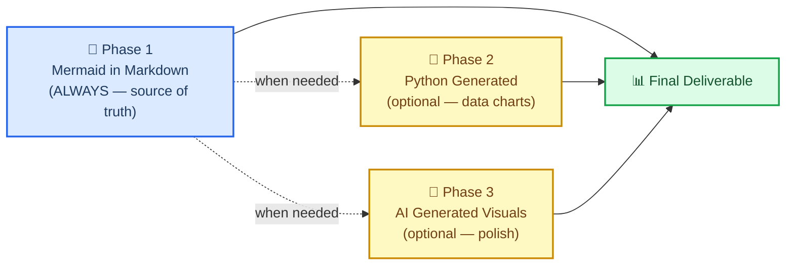

**Phase 1 is mandatory.** Even if you proceed to Phase 2 or 3, the Mermaid source stays committed.

### What Mermaid can express

Mermaid covers 24 diagram types. Almost every scientific relationship fits one:

| Use case | Diagram type | File |
| -------------------------------------------- | ---------------- | ---------------------------------------------------- |
| Experimental workflow / decision logic | Flowchart | `references/diagrams/flowchart.md` |
| Service interactions / API calls / messaging | Sequence | `references/diagrams/sequence.md` |
| Data model / schema | ER diagram | `references/diagrams/er.md` |
| State machine / lifecycle | State | `references/diagrams/state.md` |
| Project timeline / roadmap | Gantt | `references/diagrams/gantt.md` |
| Proportions / composition | Pie | `references/diagrams/pie.md` |
| System architecture (zoom levels) | C4 | `references/diagrams/c4.md` |
| Concept hierarchy / brainstorm | Mindmap | `references/diagrams/mindmap.md` |
| Chronological events / history | Timeline | `references/diagrams/timeline.md` |
| Class hierarchy / type relationships | Class | `references/diagrams/class.md` |
| User journey / satisfaction map | User Journey | `references/diagrams/user_journey.md` |
| Two-axis comparison / prioritization | Quadrant | `references/diagrams/quadrant.md` |
| Requirements traceability | Requirement | `references/diagrams/requirement.md` |
| Flow magnitude / resource distribution | Sankey | `references/diagrams/sankey.md` |
| Numeric trends / bar + line charts | XY Chart | `references/diagrams/xy_chart.md` |
| Component layout / spatial arrangement | Block | `references/diagrams/block.md` |
| Work item status / task columns | Kanban | `references/diagrams/kanban.md` |
| Cloud infrastructure / service topology | Architecture | `references/diagrams/architecture.md` |
| Multi-dimensional comparison / skills radar | Radar | `references/diagrams/radar.md` |
| Hierarchical proportions / budget | Treemap | `references/diagrams/treemap.md` |
| Binary protocol / data format | Packet | `references/diagrams/packet.md` |
| Git branching / merge strategy | Git Graph | `references/diagrams/git_graph.md` |
| Code-style sequence (programming syntax) | ZenUML | `references/diagrams/zenuml.md` |
| Multi-diagram composition patterns | Complex Examples | `references/diagrams/complex_examples.md` |

> 💡 **Pick the right type, not the easy one.** Don't default to flowcharts for everything.
> A timeline beats a flowchart for chronological events. A sequence beats a flowchart for
> service interactions. Scan the table and match.

---

## 🔧 Core workflow

### Step 1: Identify the document type

Check if a template exists before writing from scratch:

| Document type | Template |
| ------------------------------ | ----------------------------------------------- |
| Pull request record | `templates/pull_request.md` |
| Issue / bug / feature request | `templates/issue.md` |
| Sprint / project board | `templates/kanban.md` |
| Architecture decision (ADR) | `templates/decision_record.md` |
| Presentation / briefing | `templates/presentation.md` |
| Research paper / analysis | `templates/research_paper.md` |
| Project documentation | `templates/project_documentation.md` |
| How-to / tutorial | `templates/how_to_guide.md` |
| Status report | `templates/status_report.md` |

### Step 2: Read the style guide

Before writing any `.md` file: read `references/markdown_style_guide.md`.

Key rules to internalize:

- **One H1 per document** — the title. Never more.
- **Emoji on H2 headings only** — one emoji per H2, none in H3/H4
- **Cite everything** — every external claim gets a footnote `[^N]` with full URL
- **Bold sparingly** — max 2-3 bold terms per paragraph, never full sentences
- **Horizontal rule after every `</details>`** — mandatory
- **Tables over prose** for comparisons, configurations, structured data
- **Diagrams over walls of text** — if it describes flow, structure, or relationships, add Mermaid

### Step 3: Pick the diagram type and read its guide

Before creating any Mermaid diagram: read `references/mermaid_style_guide.md`.

Then open the specific type file (e.g., `references/diagrams/flowchart.md`) for the exemplar, tips, and copy-paste template.

Mandatory rules for every diagram:

```
accTitle: Short Name 3-8 Words
accDescr: One or two sentences explaining what this diagram shows.
```

- **No `%%{init}` directives** — breaks GitHub dark mode
- **No inline `style`** — use `classDef` only
- **One emoji per node max** — at the start of the label
- **`snake_case` node IDs** — match the label

### Step 4: Write the document

Start from the template. Apply the markdown style guide. Place diagrams inline with related text — not in a separate "Figures" section.

### Step 5: Commit as text

The `.md` file with embedded Mermaid is what gets committed. If you also generated a PNG or AI image, those are supplementary — the markdown is the source.

---

## ⚠️ Common pitfalls

### Radar chart syntax (`radar-beta`)

**WRONG:**
```mermaid
radar
title Example
x-axis ["A", "B", "C"]
"Series" : [1, 2, 3]
```

**CORRECT:**
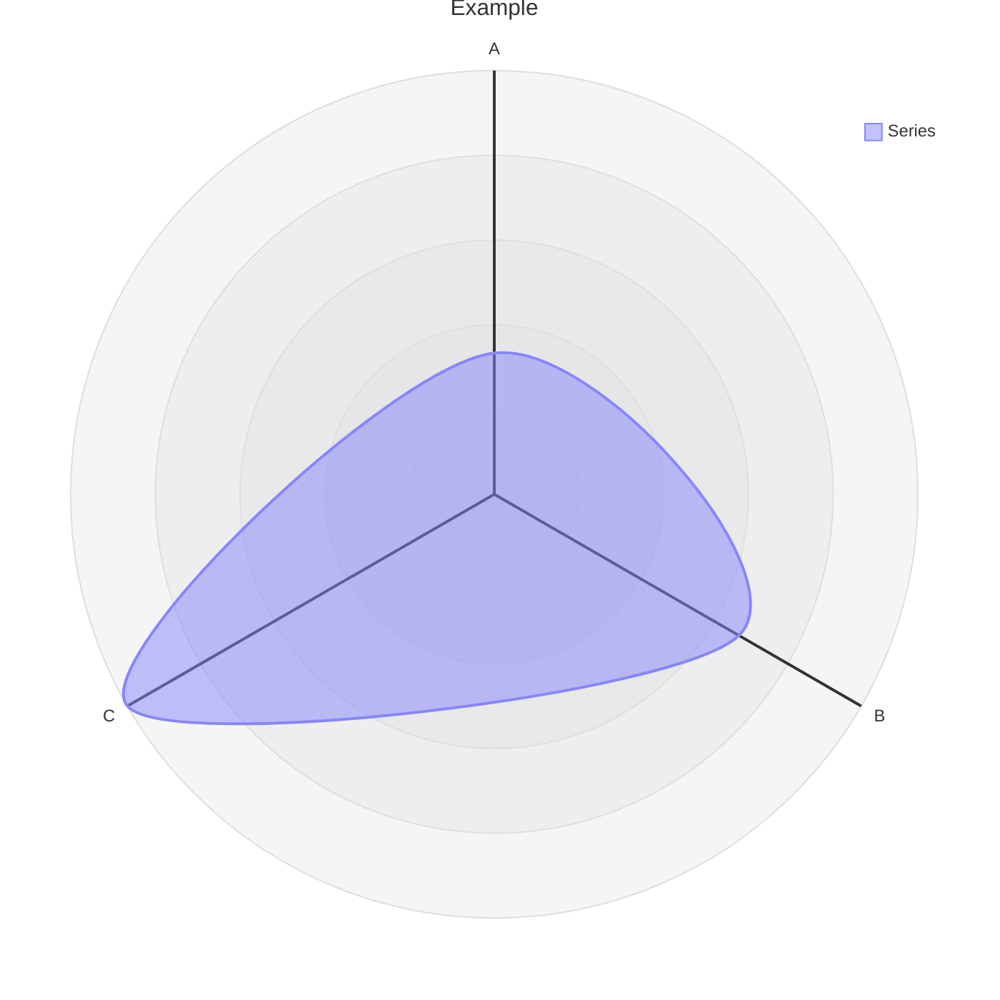

- **Use `radar-beta`** not `radar` (the bare keyword doesn't exist)
- **Use `axis`** to define dimensions, **not** `x-axis`
- **Use `curve`** to define data series, **not** quoted labels with colon
- **No `accTitle`/`accDescr`** — radar-beta doesn't support accessibility annotations; always add a descriptive italic paragraph above the diagram

### XY Chart vs Radar confusion

| Diagram | Keyword | Axis syntax | Data syntax |
| ------- | ------- | ----------- | ----------- |
| **XY Chart** (bars/lines) | `xychart-beta` | `x-axis ["Label1", "Label2"]` | `bar [10, 20]` or `line [10, 20]` |
| **Radar** (spider/web) | `radar-beta` | `axis id["Label"]` | `curve id["Label"]{10, 20}` |

### Forgetting `accTitle`/`accDescr` on supported types

Only some diagram types support `accTitle`/`accDescr`. For those that don't, always place a descriptive italic paragraph directly above the code block:

> _Radar chart comparing three methods across five performance dimensions. Note: Radar charts do not support accTitle/accDescr._


---

## 🔗 Integration with other skills

### With `scientific-schematics`

`scientific-schematics` generates AI-powered publication-quality images (PNG). Use the Mermaid diagram as the **brief** for the schematic:

```
Workflow:
1. Create the concept as Mermaid in .md (this skill — Phase 1)
2. Describe the same concept to scientific-schematics for a polished PNG (Phase 3)
3. Commit both — the .md as source, the PNG as a supplementary figure
```

### With `scientific-writing`

When `scientific-writing` produces a manuscript, all diagrams and structural figures should use this skill's standards. The writing skill handles prose and citations; this skill handles visual structure.

```
Workflow:
1. Use scientific-writing to draft the manuscript
2. For every figure that shows a workflow, architecture, or relationship:
   - Replace placeholder with a Mermaid diagram following this skill's guide
3. Use scientific-schematics only for figures that truly need photorealistic/complex rendering
```

### With `literature-review`

Literature review produces summaries with lots of relationship data. Use this skill to:

- Create concept maps (Mindmap) of the literature landscape
- Show publication timelines (Timeline or Gantt)
- Compare methodologies (Quadrant or Radar)
- Diagram data flows described in papers (Sequence or Flowchart)

### With any skill that produces output documents

Before finalizing any document from any skill, apply this skill's checklist:

- [ ] Does the document use a template? If so, did I start from the right one?
- [ ] Are all diagrams in Mermaid with `accTitle` + `accDescr`?
- [ ] No `%%{init}`, no inline `style`, only `classDef`?
- [ ] Are all external claims cited with `[^N]`?
- [ ] One H1, emoji on H2 only?
- [ ] Horizontal rules after every `</details>`?

---

## 📚 Reference index

### Style guides

| Guide | Path | Lines | What it covers |
| ----------------------- | ------------------------------------------- | ----- | -------------------------------------------------- |
| Markdown Style Guide | `references/markdown_style_guide.md` | ~733 | Headings, formatting, citations, tables, Mermaid integration, templates, quality checklist |
| Mermaid Style Guide | `references/mermaid_style_guide.md` | ~458 | Accessibility, emoji set, color classes, theme neutrality, type selection, complexity tiers |

### Diagram type guides (24 types)

Each file contains: production-quality exemplar, tips specific to that type, and a copy-paste template.

`references/diagrams/` — architecture, block, c4, class, complex\_examples, er, flowchart, gantt, git\_graph, kanban, mindmap, packet, pie, quadrant, radar, requirement, sankey, sequence, state, timeline, treemap, user\_journey, xy\_chart, zenuml

### Document templates (9 types)

`templates/` — decision\_record, how\_to\_guide, issue, kanban, presentation, project\_documentation, pull\_request, research\_paper, status\_report

### Examples

`assets/examples/example-research-report.md` — a complete scientific research report demonstrating proper heading hierarchy, multiple diagram types (flowchart, sequence, gantt), tables, footnote citations, collapsible sections, and all style guide rules applied.

---

## 📝 Attribution

All style guides, diagram type guides, and document templates in this skill are ported from the `SuperiorByteWorks-LLC/agent-project` repository under the Apache-2.0 License.

- **Source**: https://github.com/SuperiorByteWorks-LLC/agent-project
- **Author**: Clayton Young / Superior Byte Works, LLC (@borealBytes)
- **License**: Apache-2.0

This skill (as part of scientific-agent-skills) is distributed under the MIT License. The included Apache-2.0 content is compatible for downstream use with attribution retained, as preserved in the file headers throughout this skill.

---

[^1]: GitHub Blog. (2022). "Include diagrams in your Markdown files with Mermaid." https://github.blog/2022-02-14-include-diagrams-markdown-files-mermaid/

[^2]: Mermaid. "Mermaid Diagramming and Charting Tool." https://mermaid.js.org/

---

## 参考资料：references/diagrams/architecture.md

<!-- Source: https://github.com/SuperiorByteWorks-LLC/agent-project | License: Apache-2.0 | Author: Clayton Young / Superior Byte Works, LLC (Boreal Bytes) -->

# Architecture Diagram

> **Back to [Style Guide](../mermaid_style_guide.md)** — Read the style guide first for emoji, color, and accessibility rules.

**Syntax keyword:** `architecture-beta`
**Best for:** Cloud infrastructure, service topology, deployment architecture, network layout
**When NOT to use:** Logical system boundaries (use [C4](c4.md)), component layout without cloud semantics (use [Block](block.md))

> ⚠️ **Accessibility:** Architecture diagrams do **not** support `accTitle`/`accDescr`. Always place a descriptive _italic_ Markdown paragraph directly above the code block.

---

## Exemplar Diagram

_Architecture diagram showing a cloud-hosted web application with a load balancer, API server, database, and cache deployed within a VPC:_

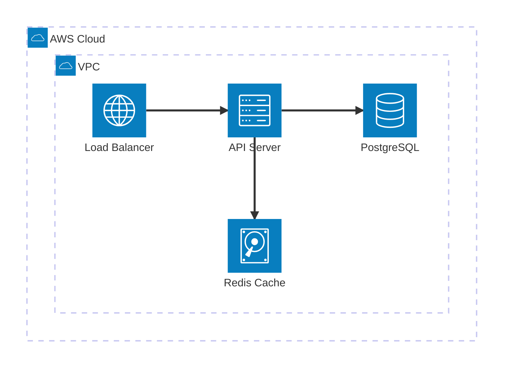

---

## Tips

- Use `group` for logical boundaries (VPC, region, cluster, availability zone)
- Use `service` for individual components
- Direction annotations on connections: `:L` (left), `:R` (right), `:T` (top), `:B` (bottom)
- Built-in icon types: `cloud`, `server`, `database`, `internet`, `disk`
- Nest groups with `in parent_group`
- **Labels must be plain text** — no emoji and no hyphens in `[]` labels (parser treats `-` as an edge operator)
- Use `-->` for directional arrows, `--` for undirected edges
- Keep to **6–8 services** per diagram
- **Always** pair with a Markdown text description above for screen readers

---

## Template

_Description of the infrastructure topology and key components:_

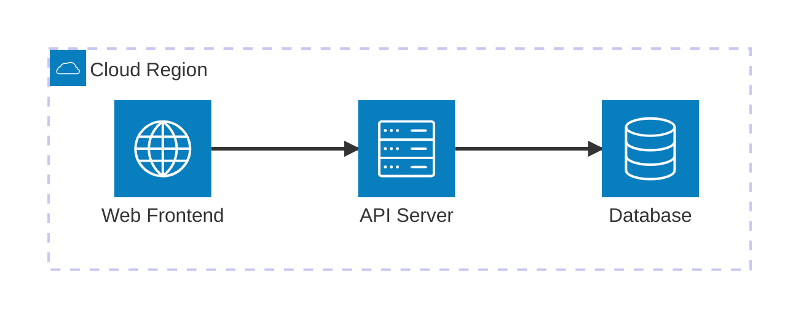

---

## Complex Example

_Multi-region cloud deployment with 3 nested groups (2 regional clusters + shared services) showing 9 services, cross-region database replication, CDN distribution, and centralized monitoring. Demonstrates how nested `group` + `in` syntax creates clear infrastructure boundaries:_

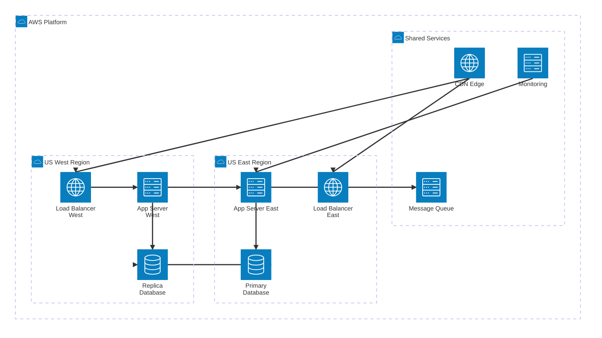

### Why this works

- **Nested groups mirror real infrastructure** — cloud > region > services is exactly how teams think about multi-region deployments. The nesting creates clear blast radius boundaries.
- **Plain text labels only** — architecture diagrams parse-fail with emoji in `[]` labels. All visual distinction comes from the group nesting and icon types (`internet`, `server`, `database`).
- **Directional annotations prevent overlap** — `:B --> T:` (bottom-to-top), `:R --> L:` (right-to-left) control where edges connect. Without these, Mermaid stacks edges on top of each other.
- **Cross-region replication is explicit** — the `db_primary:R --> L:db_replica` edge is the most important infrastructure detail and reads clearly as a horizontal connection between regions.

---

## 参考资料：references/diagrams/block.md

<!-- Source: https://github.com/SuperiorByteWorks-LLC/agent-project | License: Apache-2.0 | Author: Clayton Young / Superior Byte Works, LLC (Boreal Bytes) -->

# Block Diagram

> **Back to [Style Guide](../mermaid_style_guide.md)** — Read the style guide first for emoji, color, and accessibility rules.

**Syntax keyword:** `block-beta`
**Best for:** System block composition, layered architectures, component topology where spatial layout matters
**When NOT to use:** Process flows (use [Flowchart](flowchart.md)), infrastructure with cloud icons (use [Architecture](architecture.md))

> ⚠️ **Accessibility:** Block diagrams do **not** support `accTitle`/`accDescr`. Always place a descriptive _italic_ Markdown paragraph directly above the code block.

---

## Exemplar Diagram

_Block diagram showing a three-tier web application architecture from client-facing interfaces through application services to data storage, with emoji labels indicating component types:_

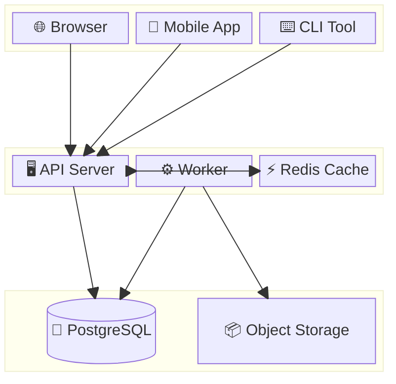

---

## Tips

- Use `columns N` to control the layout grid
- Use `space:N` for empty cells (alignment/spacing)
- Nest `block:name:span { ... }` for grouped sections
- Connect blocks with `-->` arrows
- Use **emoji in labels** `["🔧 Component"]` for visual distinction
- Use cylinder `("text")` syntax for databases within blocks
- Keep to **3–4 rows** with **3–4 columns** for readability
- **Always** pair with a Markdown text description above for screen readers

---

## Template

_Description of the system layers and how components connect:_

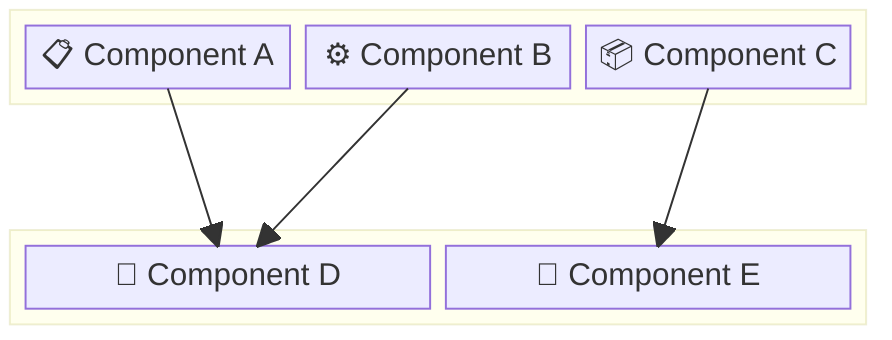

---

## Complex Example

_Enterprise platform architecture rendered as a 5-tier block diagram with 15 components. Each tier is a block group spanning the full width, with internal columns controlling component layout. Connections show the primary data flow paths between tiers:_

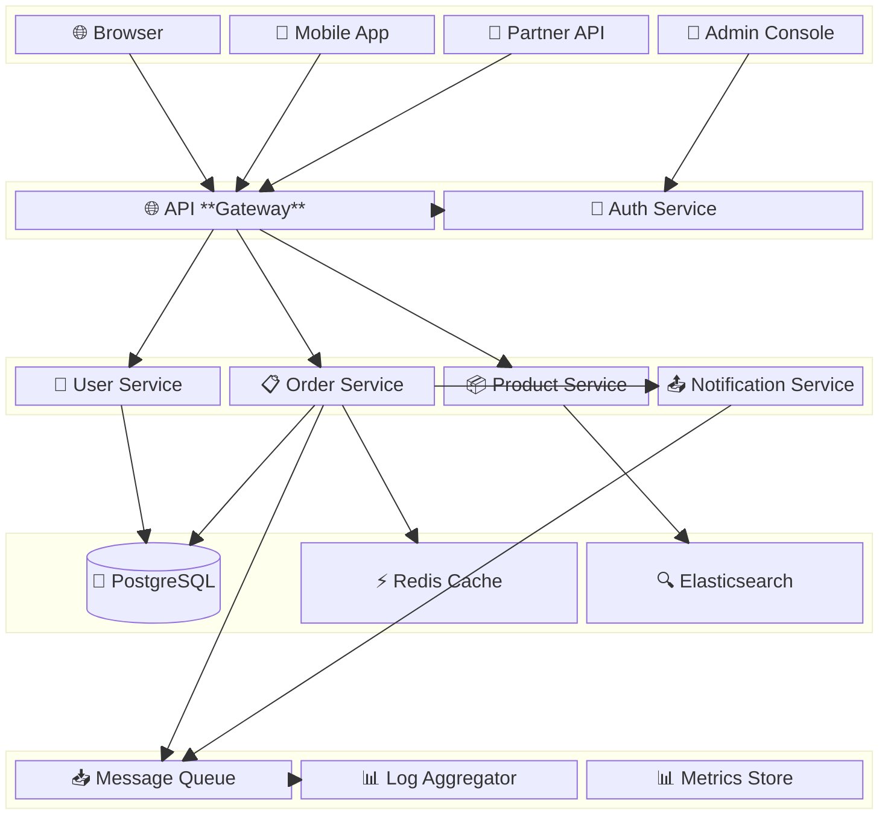

### Why this works

- **5 tiers read top-to-bottom** like a network diagram — clients, gateway, services, data, infrastructure. Each tier is a block spanning the full width with its own column layout.
- **`space:4` creates visual separation** between tiers without unnecessary lines or borders, keeping the diagram clean and scannable.
- **Cylinder syntax `("text")` for databases** — PostgreSQL renders as a cylinder, instantly recognizable as a data store. Other components use standard rectangles.
- **Connections show real data paths** — not every possible connection, just the primary flows. A fully-connected diagram would be unreadable; this shows the key paths an engineer would trace during debugging.

---

## 参考资料：references/diagrams/c4.md

<!-- Source: https://github.com/SuperiorByteWorks-LLC/agent-project | License: Apache-2.0 | Author: Clayton Young / Superior Byte Works, LLC (Boreal Bytes) -->

# C4 Diagram

> **Back to [Style Guide](../mermaid_style_guide.md)** — Read the style guide first for emoji, color, and accessibility rules.

**Syntax keyword:** `C4Context`, `C4Container`, `C4Component`
**Best for:** System architecture at varying zoom levels — context, containers, components
**When NOT to use:** Infrastructure topology (use [Architecture](architecture.md)), runtime sequences (use [Sequence](sequence.md))

---

## Exemplar Diagram — System Context

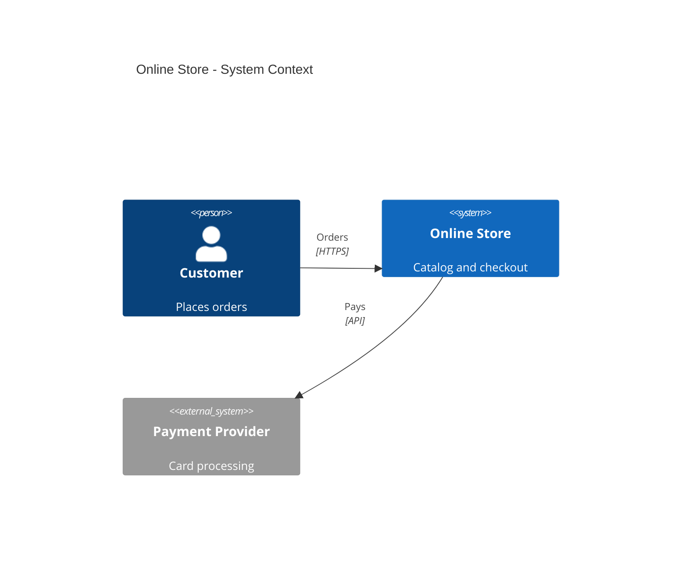

---

## C4 Zoom Levels

| Level         | Keyword       | Shows                                   | Audience        |
| ------------- | ------------- | --------------------------------------- | --------------- |
| **Context**   | `C4Context`   | Systems + external actors               | Everyone        |
| **Container** | `C4Container` | Apps, databases, queues within a system | Technical leads |
| **Component** | `C4Component` | Internal modules within a container     | Developers      |

## Tips

- Use `Person()` for human actors
- Use `System()` for internal systems, `System_Ext()` for external
- Use `Container()`, `ContainerDb()`, `ContainerQueue()` at the container level
- Label relationships with **verbs** and **protocols**: `"Reads from", "SQL/TLS"`
- Use `Container_Boundary(id, "name") { ... }` to group containers
- **Keep descriptions short** — long text causes label overlaps
- **Limit to 4–5 elements** at the Context level to avoid crowding
- **Avoid emoji in C4 labels** — the C4 renderer handles its own styling
- Use `UpdateRelStyle()` to adjust label positions if overlaps occur

---

## Template

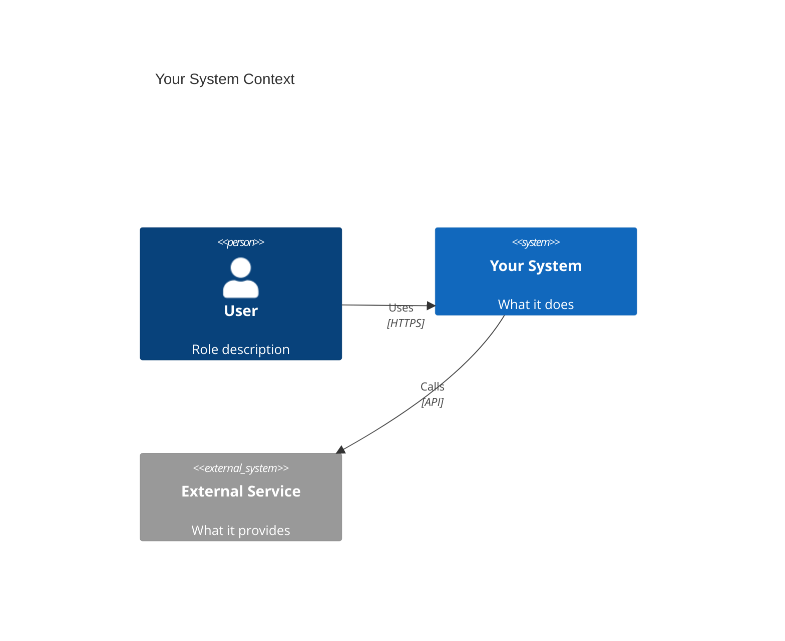

---

## Complex Example

A C4 Container diagram for an e-commerce platform with 3 `Container_Boundary` groups, 10 containers, and 2 external systems. Shows how to use boundaries to organize services by layer, with `UpdateRelStyle` offsets preventing label overlaps.

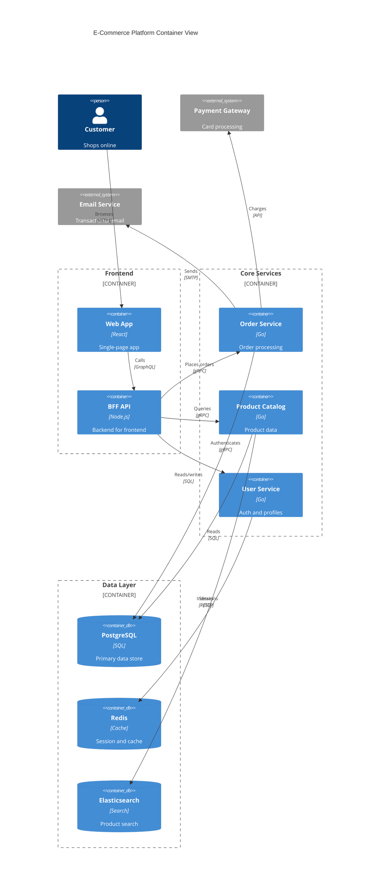

### Why this works

- **Container_Boundary groups map to deployment units** — frontend, core services, and data layer each correspond to real infrastructure boundaries (CDN, Kubernetes namespace, managed databases)
- **Every `Rel` has `UpdateRelStyle`** — C4's auto-layout stacks labels on top of each other by default. Offset every relationship to prevent overlaps, even if it seems fine at first (adding elements later will shift things)
- **Descriptions are kept to 1-3 words** — "Card processing", "Session and cache", "Auth and profiles". Long descriptions are the #1 cause of C4 rendering issues
- **Container types are semantic** — `ContainerDb` for databases gives them the cylinder icon, `Container` for services. The C4 renderer provides its own visual differentiation

---

## 参考资料：references/diagrams/class.md

<!-- Source: https://github.com/SuperiorByteWorks-LLC/agent-project | License: Apache-2.0 | Author: Clayton Young / Superior Byte Works, LLC (Boreal Bytes) -->

# Class Diagram

> **Back to [Style Guide](../mermaid_style_guide.md)** — Read the style guide first for emoji, color, and accessibility rules.

**Syntax keyword:** `classDiagram`
**Best for:** Object-oriented design, type hierarchies, interface contracts, domain models
**When NOT to use:** Database schemas (use [ER](er.md)), runtime behavior (use [Sequence](sequence.md))

---

## Exemplar Diagram

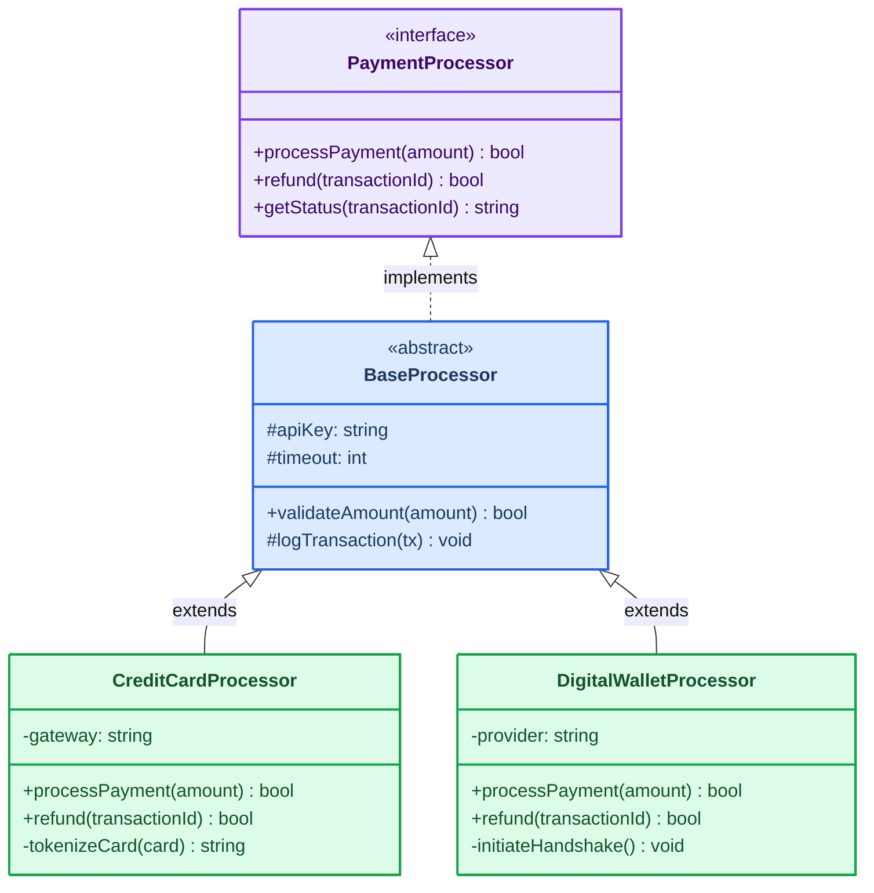

---

## Tips

- Use `<<interface>>` and `<<abstract>>` stereotypes for clarity
- Show visibility: `+` public, `-` private, `#` protected
- Keep to **4–6 classes** per diagram — split larger hierarchies
- Use `style ClassName fill:...,stroke:...,color:...` for light semantic coloring:
  - 🟣 Purple for interfaces/abstractions
  - 🔵 Blue for base/abstract classes
  - 🟢 Green for concrete implementations
- Relationship arrows:
  - `<|--` inheritance (extends)
  - `<|..` implementation (implements)
  - `*--` composition · `o--` aggregation · `-->` dependency

---

## Template

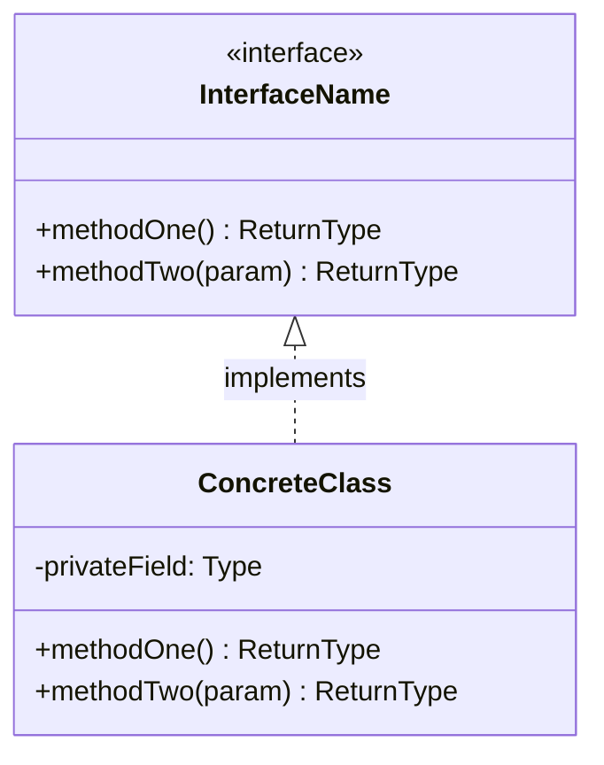

---

## Complex Example

An event-driven notification platform with 11 classes organized into 3 `namespace` groups — core orchestration, delivery channels, and data models. Shows interface implementation, composition, and dependency relationships across layers.

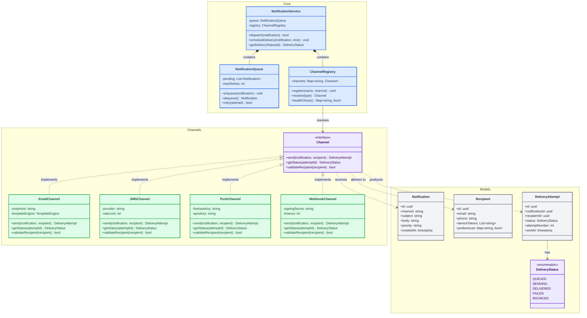

### Why this works

- **3 namespaces mirror architectural layers** — Core (orchestration), Channels (delivery implementations), Models (data). A developer can scan one namespace without reading the others.
- **Color encodes the role** — purple for interfaces/enums, blue for core services, green for concrete implementations, gray for data models. The pattern is instantly recognizable.
- **Relationship types are deliberate** — composition (`*--`) for "owns and manages", implementation (`<|..`) for "fulfills contract", dependency (`..>`) for "uses at runtime". Each arrow type carries meaning.

---

## 参考资料：references/diagrams/complex_examples.md

<!-- Source: https://github.com/SuperiorByteWorks-LLC/agent-project | License: Apache-2.0 | Author: Clayton Young / Superior Byte Works, LLC (Boreal Bytes) -->

# Composing Complex Diagram Sets

> **Back to [Style Guide](../mermaid_style_guide.md)** — This file covers how to combine multiple diagram types to document complex systems comprehensively.

**Purpose:** A single diagram captures a single perspective. Real documentation often needs multiple diagram types working together — an overview flowchart linked to a detailed sequence diagram, an ER schema paired with a state machine showing entity lifecycle, a Gantt timeline complemented by architecture before/after views. This file teaches you when and how to compose diagrams for maximum clarity.

---

## When to Compose Multiple Diagrams

| What you're documenting  | Diagram combination                                                              | Why it works                                                                        |
| ------------------------ | -------------------------------------------------------------------------------- | ----------------------------------------------------------------------------------- |
| Full system architecture | C4 Context + Architecture + Sequence (key flows)                                 | Context for stakeholders, infrastructure for ops, sequences for developers          |
| API design documentation | ER (data model) + Sequence (request flows) + State (entity lifecycle)            | Schema for the database team, interactions for backend, states for business logic   |
| Feature specification    | Flowchart (happy path) + Sequence (service interactions) + User Journey (UX)     | Process for PM, implementation for engineers, experience for design                 |
| Migration project        | Gantt (timeline) + Architecture (before/after) + Flowchart (migration process)   | Schedule for leadership, topology for infra, steps for the migration team           |
| Onboarding documentation | User Journey + Flowchart (setup steps) + Sequence (first API call)               | Experience map for product, checklist for new hires, technical walkthrough for devs |
| Incident response        | State (alert lifecycle) + Sequence (escalation flow) + Flowchart (decision tree) | Status tracking for on-call, communication for management, triage for responders    |

---

## Pattern 1: Overview + Detail

**When to use:** You need both the big picture AND the specifics. Leadership sees the overview; engineers drill into the detail.

The overview diagram shows high-level phases or components. One or more detail diagrams zoom into specific phases showing the internal interactions.

### Overview — Release Pipeline

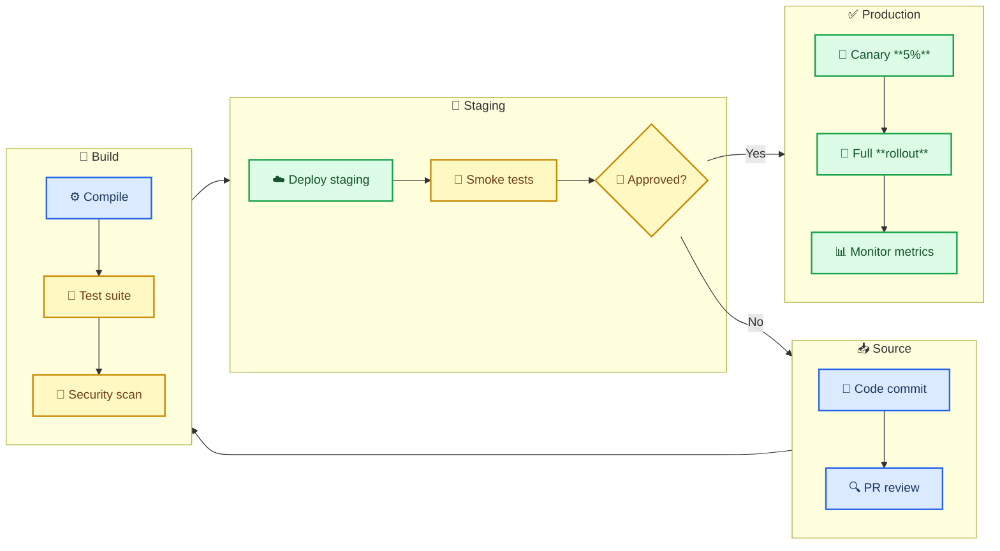

_The production deployment phase involves multiple service interactions. See the detail sequence below for the canary rollout process._

### Detail — Canary Deployment Sequence

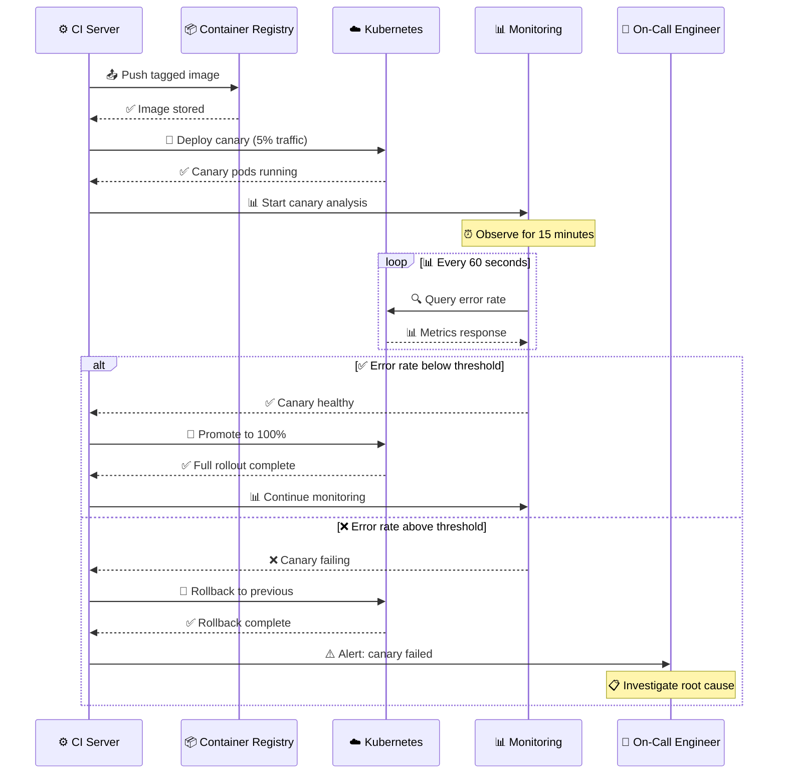

### How these connect

- The **overview flowchart** shows the full pipeline with subgraph-to-subgraph connections — leadership reads this to understand the release process
- The **detail sequence** zooms into "Canary 5% → Full rollout" from the Production subgraph, showing the actual service interactions an engineer would debug
- **Naming is consistent** — "Canary" and "Monitor metrics" appear in both diagrams, creating a clear bridge between overview and detail

---

## Pattern 2: Multi-Perspective Documentation

**When to use:** The same system needs to be documented for different audiences — database teams, backend engineers, and product managers each need a different view of the same feature.

This example documents a **User Authentication** feature from three perspectives.

### Data Model — for database team

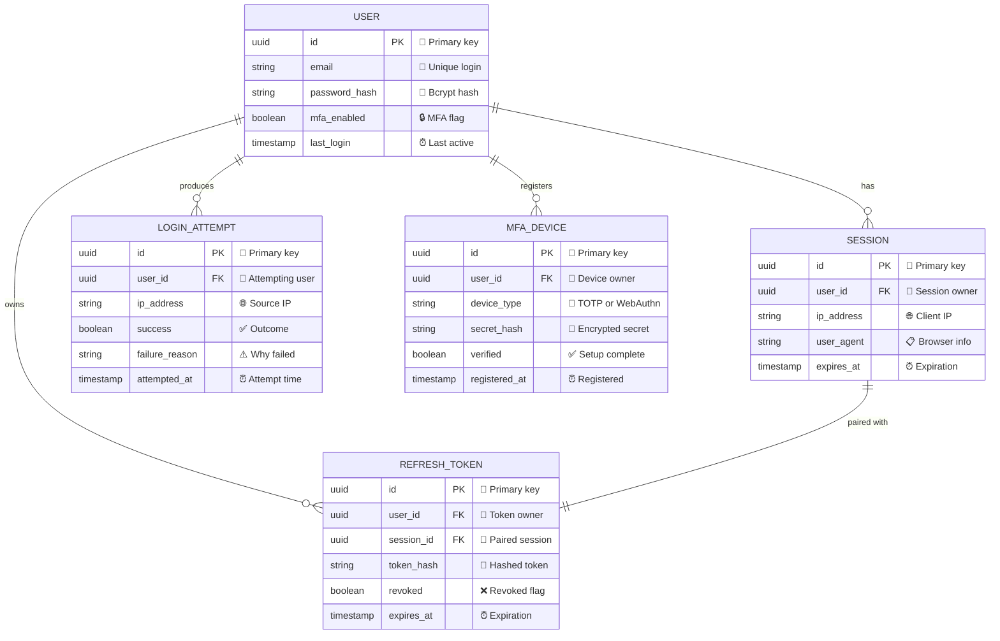

### Authentication Flow — for backend team

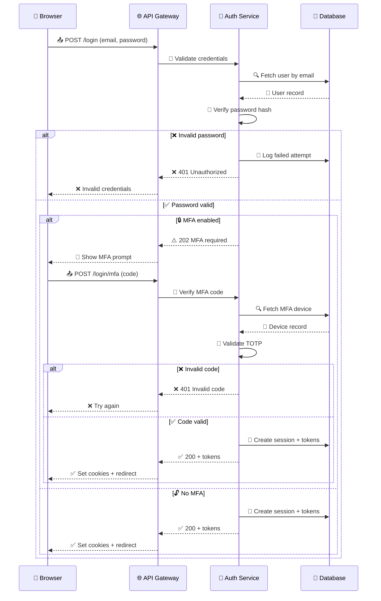

### Login Experience — for product team

```mermaid
journey
    accTitle: Login Experience Journey Map
    accDescr: User satisfaction scores across the sign-in experience for password-only users and MFA users showing friction points in the multi-factor flow

    title 👤 Login Experience
    section 🔐 Sign In
        Navigate to login          : 4 : User
        Enter email and password   : 3 : User
        Click sign in button       : 4 : User
    section 📱 MFA Challenge
        Receive MFA prompt         : 3 : MFA User
        Open authenticator app     : 2 : MFA User
        Enter 6-digit code         : 2 : MFA User
        Handle expired code        : 1 : MFA User
    section ✅ Post-Login
        Land on dashboard          : 5 : User
        See personalized content   : 5 : User
        Resume previous session    : 4 : User
```

### How these connect

- **Same entities, different views** — "User", "Session", "MFA Device" appear in the ER diagram as tables, in the sequence as participants/operations, and in the journey as experience touchpoints
- **Each audience gets actionable information** — the DB team sees indexes and cardinality, the backend team sees API contracts and error codes, the product team sees satisfaction scores and friction points
- **The journey reveals what the sequence hides** — the sequence diagram shows MFA as a clean conditional branch, but the journey map shows it's actually the worst part of the UX (scores 1-2). This drives the product decision to invest in WebAuthn/passkeys

---

## Pattern 3: Before/After Architecture

**When to use:** Migration documentation where stakeholders need to see the current state, the target state, and understand the transformation.

### Current State — Monolith

```mermaid
flowchart TB
    accTitle: Current State Monolith Architecture
    accDescr: Single Rails monolith handling all traffic through one server connected to one database showing the scaling bottleneck

    client([👤 All traffic]) --> mono[🖥️ Rails **Monolith**]
    mono --> db[(💾 Single PostgreSQL)]
    mono --> jobs[⏰ Background **jobs**]
    jobs --> db

    classDef bottleneck fill:#fee2e2,stroke:#dc2626,stroke-width:2px,color:#7f1d1d
    classDef neutral fill:#f3f4f6,stroke:#6b7280,stroke-width:2px,color:#1f2937

    class mono,db bottleneck
    class client,jobs neutral
```

> ⚠️ **Problem:** Single database is the bottleneck. Monolith can't scale horizontally. Deploy = full restart.

### Target State — Microservices

```mermaid
flowchart TB
    accTitle: Target State Microservices Architecture
    accDescr: Decomposed microservices architecture with API gateway routing to independent services each with their own data store and a shared message queue for async communication

    client([👤 All traffic]) --> gw[🌐 API **Gateway**]

    subgraph services ["⚙️ Services"]
        user_svc[👤 User Service]
        order_svc[📋 Order Service]
        product_svc[📦 Product Service]
    end

    subgraph data ["💾 Data Stores"]
        user_db[(💾 Users DB)]
        order_db[(💾 Orders DB)]
        product_db[(💾 Products DB)]
    end

    gw --> user_svc
    gw --> order_svc
    gw --> product_svc

    user_svc --> user_db
    order_svc --> order_db
    product_svc --> product_db

    order_svc --> mq[📥 Message Queue]
    mq --> user_svc
    mq --> product_svc

    classDef gateway fill:#ede9fe,stroke:#7c3aed,stroke-width:2px,color:#3b0764
    classDef service fill:#dbeafe,stroke:#2563eb,stroke-width:2px,color:#1e3a5f
    classDef datastore fill:#dcfce7,stroke:#16a34a,stroke-width:2px,color:#14532d
    classDef infra fill:#fef9c3,stroke:#ca8a04,stroke-width:2px,color:#713f12

    class gw gateway
    class user_svc,order_svc,product_svc service
    class user_db,order_db,product_db datastore
    class mq infra
```

> ✅ **Result:** Each service scales independently. Database-per-service eliminates the shared bottleneck. Async messaging decouples service dependencies.

### How these connect

- **Same layout, different complexity** — both diagrams use `flowchart TB` so the structural transformation is visually obvious. The monolith is 4 nodes; the target is 11 nodes with subgraphs.
- **Color tells the story** — the monolith uses red (danger) on the bottleneck components. The target uses blue/green/purple to show healthy, differentiated components.
- **Prose bridges the diagrams** — the ⚠️ problem callout and ✅ result callout explain _why_ the architecture changes, not just _what_ changed.

---

## Linking Diagrams in Documentation

When composing diagrams in a real document, follow these practices:

| Practice                     | Example                                                                                                                             |
| ---------------------------- | ----------------------------------------------------------------------------------------------------------------------------------- |
| **Use headers as anchors**   | `See [Authentication Flow](#authentication-flow-for-backend-team) for the full login sequence`                                      |
| **Reference specific nodes** | "The **API Gateway** from the overview connects to the services detailed below"                                                     |
| **Consistent naming**        | Same entity = same name in every diagram (User Service, not "User Svc" in one and "Users API" in another)                           |
| **Adjacent placement**       | Keep related diagrams in consecutive sections, not scattered across the document                                                    |
| **Bridging prose**           | One sentence between diagrams explaining how they connect: "The sequence below zooms into the Deploy phase from the pipeline above" |
| **Audience labels**          | Mark sections: "### Data Model — _for database team_" so readers skip to their view                                                 |

---

## Choosing Your Composition Strategy

```mermaid
flowchart TB
    accTitle: Diagram Composition Decision Tree
    accDescr: Decision flowchart for choosing between single diagram, overview plus detail, multi-perspective, or before-after composition strategies based on audience and documentation needs

    start([📋 What are you documenting?]) --> audience{👥 Multiple audiences?}

    audience -->|Yes| perspectives[📐 Multi-Perspective]
    audience -->|No| depth{📏 Need both summary and detail?}

    depth -->|Yes| overview[🔍 Overview + Detail]
    depth -->|No| change{🔄 Showing a change over time?}

    change -->|Yes| before_after[⚡ Before / After]
    change -->|No| single[📊 Single diagram is fine]

    classDef decision fill:#fef9c3,stroke:#ca8a04,stroke-width:2px,color:#713f12
    classDef result fill:#dbeafe,stroke:#2563eb,stroke-width:2px,color:#1e3a5f
    classDef start_style fill:#ede9fe,stroke:#7c3aed,stroke-width:2px,color:#3b0764

    class audience,depth,change decision
    class perspectives,overview,before_after,single result
    class start start_style
```

---

## 参考资料：references/diagrams/er.md

<!-- Source: https://github.com/SuperiorByteWorks-LLC/agent-project | License: Apache-2.0 | Author: Clayton Young / Superior Byte Works, LLC (Boreal Bytes) -->

# Entity Relationship (ER) Diagram

> **Back to [Style Guide](../mermaid_style_guide.md)** — Read the style guide first for emoji, color, and accessibility rules.

**Syntax keyword:** `erDiagram`
**Best for:** Database schemas, data models, entity relationships, API data structures
**When NOT to use:** Class hierarchies with methods (use [Class](class.md)), process flows (use [Flowchart](flowchart.md))

---

## Exemplar Diagram

```mermaid
erDiagram
    accTitle: Project Management Data Model
    accDescr: Entity relationships for a project management system showing teams, projects, tasks, members, and comments with cardinality

    TEAM ||--o{ PROJECT : "owns"
    PROJECT ||--o{ TASK : "contains"
    TASK ||--o{ COMMENT : "has"
    TEAM ||--o{ MEMBER : "includes"
    MEMBER ||--o{ TASK : "assigned to"
    MEMBER ||--o{ COMMENT : "writes"

    TEAM {
        uuid id PK "🔑 Primary key"
        string name "👥 Team name"
        string department "🏢 Department"
    }

    PROJECT {
        uuid id PK "🔑 Primary key"
        uuid team_id FK "🔗 Team reference"
        string title "📋 Project title"
        string status "📊 Current status"
        date deadline "⏰ Due date"
    }

    TASK {
        uuid id PK "🔑 Primary key"
        uuid project_id FK "🔗 Project reference"
        uuid assignee_id FK "👤 Assigned member"
        string title "📝 Task title"
        string priority "⚠️ Priority level"
        string status "📊 Current status"
    }

    MEMBER {
        uuid id PK "🔑 Primary key"
        uuid team_id FK "🔗 Team reference"
        string name "👤 Full name"
        string email "📧 Email address"
        string role "🏷️ Job role"
    }

    COMMENT {
        uuid id PK "🔑 Primary key"
        uuid task_id FK "🔗 Task reference"
        uuid author_id FK "👤 Author reference"
        text body "📝 Comment text"
        timestamp created_at "⏰ Created time"
    }
```

---

## Tips

- Include data types, `PK`/`FK` annotations, and **comment strings** with emoji for context
- Use clear verb-phrase relationship labels: `"owns"`, `"contains"`, `"assigned to"`
- Cardinality notation:
  - `||--o{` one-to-many
  - `||--||` one-to-one
  - `}o--o{` many-to-many
  - `o` = zero or more, `|` = exactly one
- Limit to **5–7 entities** per diagram — split large schemas by domain
- Entity names: `UPPER_CASE` (SQL convention)

---

## Template

```mermaid
erDiagram
    accTitle: Your Title Here
    accDescr: Describe the data model and key relationships between entities

    ENTITY_A ||--o{ ENTITY_B : "has many"
    ENTITY_B ||--|| ENTITY_C : "belongs to"

    ENTITY_A {
        uuid id PK "🔑 Primary key"
        string name "📝 Display name"
    }

    ENTITY_B {
        uuid id PK "🔑 Primary key"
        uuid entity_a_id FK "🔗 Reference"
        string value "📊 Value field"
    }
```

---

## Complex Example

A multi-tenant SaaS platform schema with 10 entities spanning three domains — identity & access, billing & subscriptions, and audit & security. Relationships show the full cardinality picture from tenant isolation through user permissions to invoice generation.

```mermaid
erDiagram
    accTitle: SaaS Multi-Tenant Platform Schema
    accDescr: Ten-entity data model for a multi-tenant SaaS platform covering identity management, role-based access, subscription billing, and audit logging with full cardinality relationships

    TENANT ||--o{ ORGANIZATION : "contains"
    ORGANIZATION ||--o{ USER : "employs"
    ORGANIZATION ||--|| SUBSCRIPTION : "holds"
    USER }o--o{ ROLE : "assigned"
    ROLE ||--o{ PERMISSION : "grants"
    SUBSCRIPTION ||--|| PLAN : "subscribes to"
    SUBSCRIPTION ||--o{ INVOICE : "generates"
    USER ||--o{ AUDIT_LOG : "produces"
    TENANT ||--o{ AUDIT_LOG : "scoped to"
    USER ||--o{ API_KEY : "owns"

    TENANT {
        uuid id PK "🔑 Primary key"
        string name "🏢 Tenant name"
        string subdomain "🌐 Unique subdomain"
        string tier "🏷️ Service tier"
        boolean active "✅ Active status"
        timestamp created_at "⏰ Created time"
    }

    ORGANIZATION {
        uuid id PK "🔑 Primary key"
        uuid tenant_id FK "🔗 Tenant reference"
        string name "👥 Org name"
        string billing_email "📧 Billing contact"
        int seat_count "📊 Licensed seats"
    }

    USER {
        uuid id PK "🔑 Primary key"
        uuid org_id FK "🔗 Organization reference"
        string email "📧 Login email"
        string display_name "👤 Display name"
        string status "📊 Account status"
        timestamp last_login "⏰ Last active"
    }

    ROLE {
        uuid id PK "🔑 Primary key"
        uuid tenant_id FK "🔗 Tenant scope"
        string name "🏷️ Role name"
        string description "📝 Role purpose"
        boolean system_role "🔒 Built-in flag"
    }

    PERMISSION {
        uuid id PK "🔑 Primary key"
        uuid role_id FK "🔗 Role reference"
        string resource "🎯 Target resource"
        string action "⚙️ Allowed action"
        string scope "🔒 Permission scope"
    }

    PLAN {
        uuid id PK "🔑 Primary key"
        string name "🏷️ Plan name"
        int price_cents "💰 Monthly price"
        int seat_limit "👥 Max seats"
        jsonb features "📋 Feature flags"
        boolean active "✅ Av
